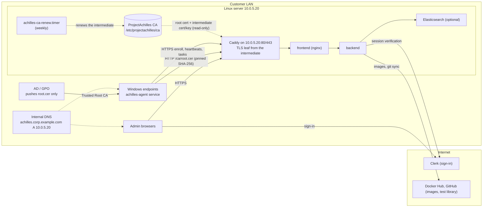

# On-Prem LAN Deployment (TUI installer, managed CA, Windows fleet)

This guide installs ProjectAchilles on a Linux server **on your LAN** with the
`achilles-installer` wizard. The setup it targets:

- a server with an **internal DNS name** (e.g. `achilles.corp.example.com`),
  **outbound internet**, and **no public IP**;
- HTTPS certificates from a **ProjectAchilles CA** that the installer creates and
  manages, limited to your DNS zone;
- a fleet of agents, **mostly Windows**, that trust that CA through **GPO** (or
  Intune) and enroll with a fingerprint-pinned bootstrap script.

It shares its engine (`scripts/deploy-server.sh`, `docker-compose.server.yml`,
Caddy) with the other server installs. For SSH-driven installs, Let's Encrypt
DNS-01 or your own certificate without the wizard, see
[`ON_PREM_SERVER.md`](./ON_PREM_SERVER.md). For the shared architecture,
configuration reference and day-2 basics, see
[`SELF_HOSTED_SERVER.md`](./SELF_HOSTED_SERVER.md).

## 1. Who this is for

| Reader | Sections to read |
|--------|------------------|
| **IT admin** installing the server | 2–6, then 9–14 |
| **AD / GPO team** distributing trust to Windows endpoints | 6 (what the CA can and cannot sign), 7, 14 |
| **Linux / macOS endpoint owners** | 8 |

You need root on the server, about an hour, and the items in
[section 3](#3-before-you-start) ready before you begin.

## 2. Architecture



- **One origin.** Caddy terminates TLS and proxies everything to the frontend,
  which proxies `/api` to the backend. Only Caddy publishes ports, and only on
  the LAN IP you pick (`CADDY_BIND_IP`).
- **The CA lives on the host.** The root key stays in `/etc/projectachilles/ca`
  and is never mounted into Caddy. Caddy sees only the root certificate and the
  intermediate certificate and key, and issues short-lived leaf certificates for
  the server name from the intermediate.
- **Plain HTTP serves one thing:** the root certificate at `/ca/root.cer` (DER)
  and `/ca/root.crt` (PEM), so an endpoint that does not trust the CA yet can
  fetch it and check it against a pinned fingerprint. Every other HTTP path
  redirects (308) to HTTPS. The bootstrap scripts are never served.
- **Clerk is in the cloud.** Browsers sign in through Clerk, so both the server
  and the admins' browsers need internet access to Clerk.

## 3. Before you start

Collect these from IT before running the installer.

| Item | Who | Why | Example |
|------|-----|-----|---------|
| **Linux server** | IT | Ubuntu 22.04 or 24.04 (Debian 12 and RHEL-family 9 are best-effort). At least 2 GiB RAM, **4 GiB for self-hosted Elasticsearch**; **20 GiB free disk** for a fresh install; root or sudo; ports 80 and 443 free; clock NTP-synchronised. | 4 vCPU, 8 GiB RAM, 40 GiB disk |
| **Static IP** (or DHCP reservation) | Network | Caddy binds to this one address. A new IP needs a re-run of the installer. | `10.0.5.20` |
| **DNS record** in your internal DNS | DNS / AD | Browsers and agents use the name. The installer prints the exact record and the AD DNS PowerShell line. | `achilles.corp.example.com A 10.0.5.20` |
| **Subnets and network firewalls** | Network | Endpoints and browsers must reach **TCP 80, TCP 443 and UDP 443** on the server. Port 80 carries the root download and the HTTPS redirect. | `10.0.0.0/16` |
| **GPO owner** | AD / GPO | Imports `root.cer` into a GPO linked to the endpoint OUs (section 7). | |
| **Clerk app** | You + whoever edits public DNS | Production keys need a public domain you own and Clerk's DNS records in its public zone; private-only names use development keys (section 4). | `pk_live_XXX` / `pk_test_XXX` |
| **Outbound internet** from the server | Network | Docker Hub (`registry-1.docker.io`), GitHub (`github.com`), Clerk (`api.clerk.com`); the image builds also download OS packages and npm/Go modules. Browsers need to reach Clerk too. | |
| **Software distribution** (optional) | Endpoint team | Intune, SCCM or an RMM tool to run the bootstrap script at scale, with the enrollment token passed at run time. | |

> **Defender ASR:** if attack surface reduction rule `01443614` runs in block
> mode, add a per-rule exclusion for exactly `C:\F0\achilles-agent.exe` (the
> path the bootstrap installs the agent to) before rollout. See
> [Self-updates](../../wiki/docs/user-guide/agent-management/self-updates.md).

## 4. DNS and Clerk: pick your situation

The installer classifies the hostname as you type it on the **Network & name**
screen. The class decides which Clerk keys it accepts and whether Let's Encrypt
DNS-01 is offered.

| | **Under a public domain you own** | **Private-only name** |
|---|---|---|
| Example | `achilles.corp.example.com`, where `example.com` has public name servers | `achilles.corp.lan`, `pa.internal`, `achilles.home.arpa` |
| How the installer decides | The registrable domain (public suffix list + 1 label) has public NS records | The name is under `.local`, `.lan`, `.internal`, `.home.arpa`, `.corp`, `.intranet` or `.localdomain`, or its registrable domain has no public NS records, or the NS lookup failed (treated as private-only, with a warning) |
| Clerk keys | **Production** (`pk_live_` + `sk_live_`) expected. Development keys (`pk_test_`) work, with a warning: they show a "Development mode" banner and have lower usage limits. | **Development keys only** (`pk_test_` + `sk_test_`). A `pk_live_` key is an error. |
| Clerk app domain | The key's Frontend API host must be `clerk.<D>`, where D is the hostname or one of its parents **down to and including the registrable domain**. For `achilles.corp.example.com`: `clerk.achilles.corp.example.com`, `clerk.corp.example.com` or `clerk.example.com`. | n/a (development instances use a `*.clerk.accounts.dev` host) |
| DNS records | Add the records Clerk's dashboard (Domains) lists to the **public** zone; sign-in fails until Clerk shows them verified. The server's own A record stays **internal-only**. | Only the internal A record. |
| Certificates | ProjectAchilles CA (default), Enterprise CA, your own files, **or Let's Encrypt DNS-01** | ProjectAchilles CA (default), Enterprise CA or your own files. DNS-01 is not offered. |

Both situations need browsers with internet access to Clerk.

Other key checks, in both situations: the publishable and secret keys must
come from the same Clerk instance (`pk_live_` with `sk_live_`, `pk_test_` with
`sk_test_`), and the installer checks that the Frontend API host is reachable
from the server.

> **Keep the internal hostname out of public DNS:** Clerk's CNAMEs reveal the
> label D in your public zone. Create the Clerk app on a parent domain (e.g.
> `clerk.example.com`) if `achilles.corp` must not appear there.

> **Avoid `.local`.** It is reserved for multicast DNS: macOS and many Linux
> clients resolve `.local` names over mDNS instead of your DNS server, which
> breaks browsers and agents. The installer warns about it. Prefer a name under a
> domain you own, or `.lan` / `.internal`.

## 5. Install

### 5.1 Get the installer onto the server

`scripts/install-onprem.sh` is the one-command bootstrap. As root, it:

1. checks the OS (Linux) and architecture (x86_64 or aarch64);
2. installs `git`, `curl` and `ca-certificates` if missing (apt-get or dnf);
3. clones the repository into `/opt/projectachilles` (or `--dir`) at the latest
   release tag (or `--ref`);
4. downloads the matching `achilles-installer-linux-amd64` / `-arm64` release
   asset and verifies it against the release's `SHA256SUMS`, refusing to install
   on a mismatch;
5. launches the wizard on your terminal.

Download, inspect, run (recommended):

```bash
curl -fsSLO https://raw.githubusercontent.com/projectachilles/ProjectAchilles/main/scripts/install-onprem.sh
less install-onprem.sh
sudo bash install-onprem.sh
```

Convenience form, if your policy allows piping to a shell:

```bash
curl -fsSL https://raw.githubusercontent.com/projectachilles/ProjectAchilles/main/scripts/install-onprem.sh | sudo bash
```

| Option | Meaning |
|--------|---------|
| `--ref REF` | Release tag (`vX.Y.Z`) or branch. Default: the highest `vX.Y.Z` tag. A branch skips the release download and builds from source. |
| `--dir DIR` | Install directory (absolute). Default: `/opt/projectachilles`. |
| `--no-run` | Stop after installing the binary at `<dir>/achilles-installer`. |

- **No release asset for the tag?** The script falls back to building the
  installer from source, which needs `go` (the version in `installer/go.mod`)
  and `make`. Releases that predate the installer have no asset and no
  `installer/` directory: use a release that ships it, or `--ref main` with Go
  installed.
- **Existing checkout:** the script refuses a directory that is not a
  ProjectAchilles git checkout, and refuses local changes. The one exception is
  `deploy/caddy/tls.caddy`, which older engines modified: it is restored
  automatically.
- **No terminal** (e.g. run from automation): the script prints the
  interactive and unattended commands instead of launching the wizard.

To start the wizard again later:

```bash
cd /opt/projectachilles && sudo ./achilles-installer install
```

The wizard needs a real terminal (80×24 or larger). With `TERM=dumb` or no TTY
it exits and points you to the unattended form (section 12).

### 5.2 The ten screens

Keys: **enter** next, **esc** back, **ctrl+c** quit. Nothing on the server
changes until you confirm on **Review**; quitting before that prints
"cancelled; nothing on this server was changed".

#### 1/10 Welcome

A first run lists the steps. On a server with an existing
`/opt/projectachilles/deploy.config.env`, it shows the installed name and
certificate mode and offers:

| Choice | Effect |
|--------|--------|
| **Reconfigure** | Change settings and re-apply; keeps data and the CA. |
| **Upgrade** | Leaves the wizard and runs `upgrade` (section 10). |
| **Status** | Leaves the wizard and runs `status` (section 10). |
| **Fresh install** | Starts from blank answers after you type the installed hostname to confirm. Data volumes, the CA and the generated secrets are kept. |

#### 2/10 Preflight checks

Read-only checks, all shown at once as PASS / WARN / FAIL. A FAIL blocks
**Next**; fix it and press **r** to re-run.

| Check | Fails when | Warns when |
|-------|-----------|-----------|
| Running as root | not root | |
| Supported operating system | not Ubuntu 22.04/24.04, Debian 12 or RHEL-family 9 | Debian 12 or RHEL-family 9 (best-effort) |
| Memory | < 2 GiB | < 4 GiB (self-hosted Elasticsearch is then disabled) |
| Free disk space (`/var/lib/docker`, else `/`) | < 20 GiB on a fresh install; < 5 GiB on an existing one | < 20 GiB on an existing install |
| Port 80 available / Port 443 available | in use (on an existing install, our own Caddy is accepted) | |
| Docker registry reachable, GitHub reachable, Clerk API reachable | | unreachable |
| Docker | | not found (the engine installs it from get.docker.com) |
| Clock synchronised | | not NTP-synchronised |

#### 3/10 Network & name

1. **Interface.** Pick the LAN interface; Caddy publishes 80/443 on its address
   only. Loopback, Docker, bridge and VPN interfaces are not listed.
2. **Server hostname.** The full name browsers and agents use. Its DNS situation
   (section 4) is shown live under the field.
3. **DNS check.** The installer checks that the name resolves **on this server**
   to the chosen IP. If it does not, it shows the record to create, for example:

   ```text
   achilles.corp.example.com.  A  10.0.5.20
   ```

   and the Active Directory DNS form, to run on a DNS server:

   ```powershell
   Add-DnsServerResourceRecordA -ZoneName "corp.example.com" -Name "achilles" -IPv4Address "10.0.5.20"
   ```

   Then choose **Re-check DNS**, **Add an /etc/hosts entry on this server and
   continue** (`HOSTS_ENTRY=true`: the engine keeps one
   `10.0.5.20 achilles.corp.example.com # projectachilles` line in `/etc/hosts`),
   or **Continue without a record for now**. The hosts entry helps only the
   server itself: endpoints still need the DNS record.
4. **LAN subnets allowed to reach HTTPS** (`LAN_SUBNETS`), comma-separated
   CIDRs, prefilled with the interface's subnet. Used only if ufw or firewalld is
   already active (section 13).

#### 4/10 Certificates

| Option | `TLS_MODE` | What you get |
|--------|-----------|--------------|
| **ProjectAchilles CA (recommended)** | `achilles-ca` | A private, name-constrained CA managed by the installer (section 6), plus the endpoint bootstrap scripts. |
| **Enterprise CA** | `byo` | The installer writes a private key and a certificate request (`deploy/caddy/certs/request.csr`) for the hostname. Your CA signs it as a TLS server certificate (serverAuth); you then give the path to the signed PEM chain. |
| **Bring your own certificate and key files** | `byo` | Paths to a PEM chain (server certificate first) and an unencrypted PEM key. They are validated (key matches, name matches, not expired) and copied to `deploy/caddy/certs/`. |
| **Let's Encrypt DNS-01** | `acme-dns` | Publicly trusted certificates; asks for an email, the Caddy DNS plugin name and an API token that can edit TXT records. Offered only for names under a public domain. |

The rest of this guide assumes the ProjectAchilles CA. With Enterprise CA or
your own files, endpoints must already trust your CA, and no bootstrap scripts
are rendered.

For the ProjectAchilles CA the screen then asks:

- **Which DNS zone may the CA issue certificates for?** The choices are the
  hostname's parents, nearest first, down to the registrable domain (e.g.
  `corp.example.com`, `example.com`). The zone is fixed into the root and
  can't be widened later without a new root on every endpoint, so pick the
  narrowest zone (`CA_ZONE`).
- **Also allow the LAN IP in certificates?** (`CA_INCLUDE_IP`). No (the default)
  means the CA can't issue for any IP address. Yes permits exactly the LAN IP.
  Neither makes the site reachable by IP: it answers on its DNS name only.
- **An existing CA that doesn't match** the chosen zone or IP policy: **Keep the
  existing CA**, or **Rotate** (`CA_ROTATE=true`: a new root, which every
  endpoint must re-trust). If the hostname is outside the existing CA's zone,
  keeping it isn't possible.

On an existing install, changing the certificate mode shows a warning: browsers
and enrolled agents must trust the new issuer before they can connect again.

#### 5/10 Login (Clerk)

Paste the **Clerk publishable key** and **Clerk secret key** (from the Clerk
dashboard, API Keys). The screen decodes the publishable key offline, checks it
against section 4's rules, and probes the Frontend API host from the server
("Frontend API: … · reachable from this server"). An error blocks Next; a
warning does not. For a production key it then asks whether you have published
the DNS records Clerk lists (sign-in fails until they are verified).

#### 6/10 Analytics

**Self-hosted on this server** (an Elasticsearch container; unavailable when the
memory check did not pass) or **Elastic Cloud** (Cloud ID plus an API key with
read and write access to the `achilles-*` indices). Optionally **load demo
data** (about 1000 synthetic results); leave it off for production.

#### 7/10 Organisation

- **Organisation name** (`ORGANIZATION_NAME`, at most 56 characters), printed on
  execution reports.
- **Test library repository** and **branch** (default
  `https://github.com/ubercylon8/f0_library.git`, `main`).
- **GitHub token**, only for a private test library (scope `repo`).

#### 8/10 Review

Every setting with secrets masked, the settings file
(`/opt/projectachilles/deploy.config.env`, mode 600), and the unattended
equivalent command. **Yes, install** writes the file and starts the install.

#### 9/10 Install

A phase checklist plus a live log. **esc** stops the engine after a
confirmation; after a stop or a failure, **r** re-runs the whole install (every
phase is idempotent), **q** quits, and the last 30 log lines are shown.

| Phase id | Checklist title | Runs for |
|----------|-----------------|----------|
| `config` | Loading configuration | always (also writes the `/etc/hosts` entry when `HOSTS_ENTRY=true`) |
| `validate` | Validating settings | always |
| `docker` | Checking Docker | always (installs Docker if missing) |
| `ca` | Preparing the ProjectAchilles CA | `achilles-ca` |
| `caddy-render` | Configuring Caddy TLS | always (writes `deploy/caddy/rendered/`) |
| `backend-env` | Writing backend/.env | always |
| `root-env` | Writing root .env | always |
| `firewall` | Opening 80/443 to the LAN subnets | when `LAN_SUBNETS` is set |
| `up` | Building and starting the stack | always (several minutes on the first run) |
| `ca-export` | Exporting Caddy's internal root CA | `internal` only (skipped here) |
| `bootstrap` | Rendering endpoint bootstrap scripts | `achilles-ca` |
| `renew-timer` | Installing the weekly CA renewal timer | `achilles-ca` |

If the wizard ends with a failed install, your answers are saved: run the
wizard again (Reconfigure) or the unattended command it prints.

#### 10/10 Done

The hand-over screen (also printed to the terminal when you leave):

- the URL and LAN IP;
- the root CA files, `/etc/projectachilles/ca/public/root.cer` (DER, for GPO)
  and `root.crt` (PEM);
- the root's **SHA-256** fingerprint and its **Windows thumbprint** (SHA-1),
  which is how the root appears in `Cert:\LocalMachine\Root`;
- the bootstrap scripts, `/opt/projectachilles/deploy/onprem/bootstrap-windows.ps1`
  and `bootstrap-unix.sh`, with the commands to run them;
- the GPO path for the root (section 7) and the next steps: sign in and create
  the first admin, register an agent version, create an enrollment token;
- the day-2 commands.

**Save the SHA-256 and the thumbprint**: the GPO team uses them to verify the
file they import. `sudo /opt/projectachilles/achilles-installer ca export --out <dir>`
prints both again at any time.

### 5.3 First sign-in and agent version

1. Open `https://achilles.corp.example.com` from a machine that trusts the root
   (section 7) and sign in through Clerk.
2. Register an agent version under **Settings → Agent** (build or upload); it
   must appear under **Registered Versions**. Until then the agent download
   returns 404 and the bootstrap fails at "Downloading agent".
3. Create an enrollment token in the web UI. Give it a short TTL and a
   **Max Uses** that matches the batch you are enrolling.

> The web UI's enrollment one-liners download the agent over HTTPS from the
> start, so they fail on an endpoint that doesn't trust the root yet. For this
> setup, use the bootstrap scripts below.

## 6. The ProjectAchilles CA

`achilles-installer ca init` (run by the engine's `ca` phase) creates a
two-level CA under `/etc/projectachilles/ca`:

| | Root CA | Intermediate CA |
|---|---|---|
| Name | `ProjectAchilles Root CA – <org or hostname>` | `ProjectAchilles Intermediate CA – <org or hostname>` |
| Key | ECDSA P-256 | ECDSA P-256 |
| Validity | 10 years | 2 years (never past the root) |
| Path length | 1 | 0 (cannot sign further CAs) |
| Key usage | Certificate Sign, CRL Sign | Certificate Sign, CRL Sign |
| Extended key usage | serverAuth only | serverAuth only |
| Name constraints (critical) | DNS: the chosen zone and its subdomains. IP: all excluded, or exactly the LAN IP when allowed | same as the root |

Caddy issues the server's leaf certificate from the intermediate (`tls internal`
with Caddy's `pki` pointed at the installer's intermediate) and renews it on its
own. Leaves are short-lived (Caddy's default is 12 hours).

### What the constraints cover

- **DNS names.** Name-constraint-aware clients (Windows CryptoAPI, Go, OpenSSL,
  .NET, current browsers) reject any certificate from this CA for a name outside
  the zone. A leaf for `login.microsoftonline.com` signed with the real
  intermediate key fails validation on Windows and Linux.
- **IP addresses.** By default every IP SAN is excluded (`0.0.0.0/0` and `::/0`),
  because an absent IP constraint would leave IPs unconstrained. With the LAN IP
  allowed, only that single address is permitted.
- **Usage.** The serverAuth EKU on both CA certificates limits what anything
  under them is valid for to TLS server authentication: not code signing, client
  authentication or email.
- **Depth.** The intermediate cannot create further CAs (path length 0).

### What they don't cover

- **Anything inside the zone.** Whoever holds the intermediate or root key can
  mint a valid server certificate for **any** name in the zone (for example
  `mail.corp.example.com`) for every client that trusts the root. Pick the
  narrowest zone; if `corp.example.com` hosts other important services, consider
  a dedicated subdomain for the server (e.g. `achilles.pa.corp.example.com`
  with zone `pa.corp.example.com`).
- **Clients that ignore name constraints.** Old or embedded TLS stacks may not
  enforce them. On Windows, DNS constraints are applied to a certificate with no
  SAN (CN only) in a server-auth context, which every TLS client uses; custom
  code that builds an `X509Chain` without the serverAuth policy would accept it.
- **Revocation.** There is no CRL or OCSP. A compromised CA is handled by
  rotating it and removing the old root from every endpoint.
- **The server itself.** Anyone with root on the server can use the CA keys.

### Key custody

| Path (under `/etc/projectachilles/ca`) | Contents | Who sees it |
|------|----------|------------|
| `root.key`, `root.crt` | Root key and certificate | Host only (dir 0700, key 0600); **never mounted into Caddy** |
| `caddy/root.crt`, `caddy/intermediate.crt`, `caddy/intermediate.key` | What Caddy needs | Mounted read-only into the Caddy container |
| `public/root.crt` (PEM), `public/root.cer` (DER) | The root certificate only | Served over plain HTTP at `/ca/root.crt` and `/ca/root.cer` |

The renewal job runs as root from root-owned copies of the installer and
`ca-renew.sh` in `/usr/local/lib/projectachilles/`, never from the repository
checkout, which the install user may be able to write.

### Intermediate renewal

The engine installs `achilles-ca-renew.timer` (weekly, persistent). Its service
runs `ca-renew.sh`, which:

1. runs `achilles-installer ca renew --if-expiring 180d`: a new intermediate,
   with the root's constraints, once fewer than 180 days remain;
2. restarts Caddy when the intermediate on disk is newer than the running
   container, after deleting Caddy's cached leaf certificates so the next leaf
   chains to the current intermediate.

Endpoints are unaffected: leaves keep chaining to the same root. `status` warns
when the intermediate has fewer than 90 days left, or the root less than a year.

```bash
systemctl list-timers achilles-ca-renew.timer         # next run
sudo systemctl start achilles-ca-renew.service        # run the check now
journalctl -u achilles-ca-renew.service               # its output
```

A manual `sudo /opt/projectachilles/achilles-installer ca renew` renews but does
not restart Caddy; it prints the restart command, and the next timer run or
engine run picks it up as well. When an install run changes the CA (creation or
rotation), the engine itself restarts Caddy and clears its leaf cache.

### Rotation

Rotation is never automatic. A new root means every endpoint must re-trust it.

1. In the wizard choose **Reconfigure**, pick the new zone or IP policy, then
   **Rotate** on the Certificates screen (or set `CA_ROTATE=true` in
   `deploy.config.env` and run the unattended install). `CA_ROTATE=true`
   replaces only a root whose constraints differ from `CA_ZONE` /
   `CA_INCLUDE_IP`, so leaving it set does not rotate on every run.
2. The engine re-renders the bootstrap scripts with the new pin and restarts
   Caddy onto the new CA.
3. Replace the root in the GPO (import the new `root.cer`, delete the old one),
   and update any copies of the bootstrap script.

Until an endpoint has the new root, it does not trust the server, and its agent
stays offline. To add the new root during the transition without re-enrolling,
see [7.4](#74-manual-trust-only).

## 7. Distributing trust and enrolling Windows endpoints

Two separate jobs:

- **Trust:** the root must be in `Cert:\LocalMachine\Root` **before** the agent
  enrolls, because enrollment verifies the server against the OS trust store.
  GPO or Intune does this for the fleet; the bootstrap script does it per machine
  (and skips it when the root is already there).
- **Enrollment:** the bootstrap script, run per machine with an enrollment token.

> **GPO distributes the root only.** Never put enrollment tokens, or a script
> that contains one, in a GPO, a startup script or SYSVOL: every domain computer
> and user can read SYSVOL.

### 7.1 GPO: push the root

1. Get `root.cer` and check it. On the server:

   ```bash
   sudo /opt/projectachilles/achilles-installer ca export --out /root/achilles-root
   ```

   This writes `root.cer` and `root.crt` and prints the SHA-256 and the SHA-1
   thumbprint. Copy `root.cer` to the GPO admin workstation and compare:

   ```powershell
   (Get-FileHash -Algorithm SHA256 .\root.cer).Hash
   ```

   The hash must equal the installer's SHA-256 with the colons removed.
2. In Group Policy Management, edit (or create) a GPO linked to the OUs that hold
   the endpoints and browser machines.
3. Go to **Computer Configuration → Policies → Windows Settings → Security
   Settings → Public Key Policies → Trusted Root Certification Authorities**,
   right-click, **Import**, and select `root.cer`.
4. Endpoints apply it at the next policy refresh, or immediately with
   `gpupdate /force`.

Only the root is needed: Caddy sends the intermediate with every handshake.

### 7.2 Intune alternative

Create a **Trusted certificate** profile (Devices → Manage devices →
Configuration → Create; platform Windows 10 and later; Templates → Trusted
certificate), upload `root.cer`, and set **Destination Store** to **Computer
certificate store - Root**. Assign it to the device groups.

### 7.3 Enroll with the bootstrap script

The script is generated on the server at
`/opt/projectachilles/deploy/onprem/bootstrap-windows.ps1` with the hostname and
the root's SHA-256 pinned inside. It is not served over HTTP: copy it from the
server over a channel you trust (SSH/SCP, or a share only admins can write),
because its pin is what makes the plain-HTTP root download safe.

Run it from an **elevated** PowerShell (Windows PowerShell 5.1 or later), in the
folder that holds it:

```powershell
powershell -ExecutionPolicy Bypass -File .\bootstrap-windows.ps1 -Token '<enrollment-token>'
```

Replace `<enrollment-token>` with a token from the web UI (keep the quotes).

It runs these steps, aborting at the first failure:

1. **Locks `C:\F0`**: owner Administrators; a protected DACL with full control for
   SYSTEM and Administrators, and ReadPermissions for OWNER RIGHTS.
2. **Normalizes everything already under `C:\F0`**: each item gets owner
   Administrators and inherited-only permissions, then a second walk verifies it.
   It **aborts on any junction, symbolic link or other reparse point** under
   `C:\F0`. All of this happens before anything is downloaded.
3. **Downloads the root** from `http://achilles.corp.example.com/ca/root.cer`
   into memory and aborts unless its SHA-256 equals the pinned value ("Root CA
   fingerprint mismatch … Aborting; nothing was trusted.").
4. **Trusts those same verified bytes** in `Cert:\LocalMachine\Root`, or prints
   "Root CA already trusted (e.g. via GPO); skipping import." No file is written.
5. **Downloads the agent over HTTPS** (`/api/agent/download?os=windows&arch=amd64`)
   into memory and writes it to a new file in `C:\F0` created with owner
   Administrators and a SYSTEM + Administrators DACL. If the AchillesAgent service
   is running, it stops it and waits for its process to exit, then renames the
   file to `C:\F0\achilles-agent.exe`.
6. **Enrolls and installs the service:** `--enroll <token> --server https://… --install`.
   The script's exit code is the agent's.

Nothing is staged in `%TEMP%` or any folder the user's unelevated token can
write to.

> **Operator note: existing `C:\F0` content becomes SYSTEM + Administrators only.**
> Anything already in `C:\F0` (earlier test artifacts, logs, `bundle_results.json`)
> loses its own permissions and inherits the locked DACL; non-administrators can
> no longer list or read the folder. The agent runs as SYSTEM, so it is
> unaffected. A junction or symbolic link anywhere under `C:\F0` stops the install
> before any download: remove it and run the script again. The lock and
> normalization run even when the script later aborts (for example on a
> fingerprint mismatch).

**At scale:** run the same command through Intune, SCCM or an RMM tool that runs
it elevated, passing the token at run time. Use a token with a short TTL and a
Max Uses sized to the batch, and don't store it where everyone can read it.

**Re-runs:** running the script again on an enrolled machine replaces the binary
and enrolls the machine again, as a new agent ID (one more token use). If that
re-enrollment fails, the previously installed agent is left stopped; start it
with `Start-Service AchillesAgent`.

### 7.4 Manual, trust only

To add a root without enrolling (a machine outside GPO, or a CA rotation), copy
`root.cer` to the machine by your usual means and, elevated:

```powershell
(Get-FileHash -Algorithm SHA256 .\root.cer).Hash
Import-Certificate -FilePath .\root.cer -CertStoreLocation Cert:\LocalMachine\Root
```

Import only if the hash equals the installer's SHA-256 (without colons).

### 7.5 Verify on an endpoint

```powershell
# GPO applied? (computer section, elevated)
gpresult /r /scope computer

# Root present? Use the Windows thumbprint (SHA-1) from the Done screen or `ca export`.
Get-ChildItem Cert:\LocalMachine\Root | Where-Object Thumbprint -eq '<SHA-1 thumbprint>'

# Name resolves and HTTPS validates (no certificate error)
Resolve-DnsName achilles.corp.example.com
(Invoke-WebRequest -UseBasicParsing -Uri 'https://achilles.corp.example.com/api/health').StatusCode

# Agent installed and running
Get-Service AchillesAgent
```

**Browsers:** Edge and Chrome use the Windows store. Firefox 120 and later
import roots from the Windows (and macOS) store by default (Settings → Privacy &
Security → Certificates); if that was turned off, or on older versions, enable
it, or set the `ImportEnterpriseRoots` enterprise policy.

## 8. Linux and macOS endpoints

`bootstrap-unix.sh` is rendered next to the Windows script, with the same pin.
Copy it from the server over a trusted channel and run it as root:

```bash
sudo bash bootstrap-unix.sh <enrollment-token>
# or keep the token out of the argument list:
ACHILLES_TOKEN=<enrollment-token> sudo -E bash bootstrap-unix.sh
```

It downloads `root.cer` over HTTP, aborts unless its SHA-256 matches the pin,
then trusts it system-wide:

| Platform | Trust store |
|----------|-------------|
| Debian / Ubuntu | `/usr/local/share/ca-certificates/achilles-root-ca.crt` + `update-ca-certificates` |
| Fedora / RHEL | `/etc/pki/ca-trust/source/anchors/achilles-root-ca.crt` + `update-ca-trust` |
| macOS | System keychain (`security add-trusted-cert`) |

It then downloads the agent over HTTPS for the machine's OS and architecture,
installs it at `/opt/f0/achilles-agent`, and enrolls it with `--install`. It
needs `curl`, `sha256sum` or `shasum`, and on Linux `openssl`.

Browsers on Linux may keep their own certificate store; import `root.crt` there
if they show a warning.

## 9. Verify

On the server:

```bash
sudo /opt/projectachilles/achilles-installer status
sudo curl -s --cacert /etc/projectachilles/ca/public/root.crt https://achilles.corp.example.com/api/health
curl -sI http://achilles.corp.example.com/ca/root.cer    # 200
curl -sI http://achilles.corp.example.com/                # 308 to https://
sudo ss -ltnup | grep -E ':(80|443) '                     # only 10.0.5.20
```

`status` reports the containers, the HTTPS health check (verified against the
ProjectAchilles root), the server certificate's issuer and expiry, the
intermediate and root expiry with the root's SHA-256, free disk, and the last
backup. It exits non-zero when anything warns or fails. Right after an install,
Caddy may show "health starting" for about a minute.

From endpoints: section 7.5, then check that the agent appears in the web UI
and sends heartbeats.

## 10. Day-2

Run the installer as root from the checkout:

```bash
cd /opt/projectachilles
sudo ./achilles-installer <command>
```

| Command | What it does |
|---------|--------------|
| `status` | Health, certificates, disk, last backup (section 9). |
| `upgrade [--ref TAG] [--yes]` | Moves the checkout to the next release tag (or `--ref`) and re-runs the engine with the existing config. Shows `Upgrade: <from> -> <to>` and the changelog link, and asks for confirmation unless `--yes`. Refuses a working tree with uncommitted changes (it restores an old-engine `deploy/caddy/tls.caddy` first). On failure it prints the rollback steps. |
| `backup [--out DIR]` | Stops the stack briefly and writes `/var/backups/projectachilles/<UTC timestamp>.tar.gz` (or `.tar.zst` when available), mode 0600: the `achilles-data`, `caddy-data` and `esdata` volumes, the CA directory **including the root key**, `deploy.config.env`, `.env` and `backend/.env`. Restarts the stack afterwards, even on failure. |
| `restore FILE [--yes]` | Overwrites the volumes, configuration, `.env` files and CA with the backup's. Asks you to type the hostname unless `--yes`. |
| `ca export --out DIR` | Writes `root.crt` and `root.cer` and prints the SHA-256 and SHA-1 thumbprint. |
| `ca bootstrap --host NAME --out DIR` | Re-renders the bootstrap scripts (the engine does this on every run, into `deploy/onprem/`). |
| `ca renew [--if-expiring 180d]` | Renews the intermediate if due (prints `renewed` or `not due`); restart Caddy afterwards (section 6). |
| `ca init --zone ZONE [--ip IP --include-ip] [--rotate]` | Low-level CA creation, normally run by the engine. `--rotate` replaces the root. |
| `version` | Prints the installer version. |

`status`, `upgrade`, `backup` and `restore` accept `--repo DIR` and `--ca-dir DIR`;
the `ca` commands take `--dir DIR` (default `/etc/projectachilles/ca`).

### Upgrading

- **Use `upgrade`, or re-run the engine after any `git pull`.** Caddy's
  configuration is rendered into `deploy/caddy/rendered/` from the checkout, so a
  pulled checkout needs `./scripts/deploy-server.sh` (or `achilles-installer
  upgrade`) to apply it.
- **The installer binary is updated separately.** `upgrade` checks out the new
  release but keeps running the existing binary, and prints the command to update
  it, for example:

  ```bash
  sudo /opt/projectachilles/scripts/install-onprem.sh --dir /opt/projectachilles --ref <tag> --no-run
  ```

  Then run the unattended install once (section 12) so the engine and the
  renewal timer's root-owned copy in `/usr/local/lib/projectachilles/` use the
  new binary.

### Backups

The backup file holds every secret of the install (Clerk keys, session and
encryption secrets, API keys) **and the CA private keys**. Anyone who reads it
can impersonate your CA within its zone. Store it encrypted and off the server.

## 11. Moving to a public IP later

Switching certificate source is a re-run with different answers, not a
reinstall. The data and the hostname stay.

- **Same name, publicly trusted certificate, still no inbound access:** if the
  name is under a public domain, run the wizard, choose **Reconfigure**, and pick
  **Let's Encrypt DNS-01** on the Certificates screen.
- **Public IP with inbound 80/443:** edit `deploy.config.env`: set
  `TLS_MODE=acme-http` and `ACME_EMAIL`, set `CADDY_BIND_IP` to the public
  address (or leave it empty to publish on every address), publish a public A
  record, and run the unattended install (section 12). The engine adds firewall
  rules only for `LAN_SUBNETS`; opening 80/443 to the internet is up to you.

In both cases:

- Use production Clerk keys for the public domain.
- Enrolled agents keep working when the hostname stays the same, since a
  publicly trusted certificate validates through the OS store. A new hostname
  means re-enrolling them.
- The ProjectAchilles CA stays in `/etc/projectachilles/ca`, and the root stays
  trusted on endpoints until you remove it from the GPO. If you no longer use
  the CA, also stop its timer: `sudo systemctl disable --now achilles-ca-renew.timer`.

## 12. Unattended install

The wizard's answers are a plain `deploy.config.env`, so an install can run
without prompts, for automation or a second identical server. Get the binary
first (`sudo bash install-onprem.sh --no-run`), then write
`/opt/projectachilles/deploy.config.env` (see `deploy.config.env.example` for
every key) and `chmod 600` it:

```ini
ACHILLES_DOMAIN='achilles.corp.example.com'
ORGANIZATION_NAME='Acme Corp'
TLS_MODE='achilles-ca'
CADDY_BIND_IP='10.0.5.20'
LAN_SUBNETS='10.0.5.0/24'
CA_ZONE='corp.example.com'
CA_INCLUDE_IP='false'
CA_ROTATE='false'
HOSTS_ENTRY='false'
CLERK_PUBLISHABLE_KEY='pk_live_XXX'
CLERK_SECRET_KEY='sk_live_XXX'
ES_MODE='self'
SEED_ES='false'
```

Then:

```bash
cd /opt/projectachilles
sudo ./achilles-installer install --config /opt/projectachilles/deploy.config.env        # dry run
sudo ./achilles-installer install --config /opt/projectachilles/deploy.config.env --yes  # install
```

| Exit status | Meaning |
|-------------|---------|
| 0 | Installed. |
| 1 | The config failed validation (each problem is printed by key; nothing changed), or another error. |
| 2 | Without `--yes`: printed what would run; nothing changed. |
| 130 | Interrupted; running the same command again is safe. |
| other | The engine's own exit status; fix the reported problem and re-run. |

The engine runs with `ACHILLES_PROGRESS=1` and `ACHILLES_NONINTERACTIVE=1`, so it
never prompts and prints one line per phase. Leave `SESSION_SECRET`,
`ENCRYPTION_SECRET` and `CLI_AUTH_SECRET` empty: the first run generates them and
later runs reuse the values in `backend/.env`.

The unattended path validates required keys but does **not** run the wizard's
Clerk key and DNS checks (section 4): check the key fit yourself.

## 13. Troubleshooting

### Docker-published ports bypass ufw and firewalld

Docker publishes container ports through its own iptables NAT chains, which
handle the traffic before the host firewall's input rules see it. A ufw "deny"
therefore does not stop a published port. That is why the installer binds Caddy
to the LAN IP (`CADDY_BIND_IP`) instead of relying on the host firewall: the
other interfaces of the server don't listen on 80/443 at all.

The firewall phase still adds allow rules for 80/tcp, 443/tcp and 443/udp from
each `LAN_SUBNETS` entry when ufw or firewalld is **already active**. It never
enables an inactive firewall and never touches port 22. To restrict which
subnets can reach the LAN IP, use your network firewall (or Docker's
`DOCKER-USER` chain).

### Symptoms

| Symptom | Cause and fix |
|---------|---------------|
| Browser shows a certificate warning | The root is not trusted on that machine: check GPO (`gpresult /r /scope computer`) and the root (7.5). Firefox: see 7.5. |
| Bootstrap: `Root CA fingerprint mismatch: expected …, got …. Aborting; nothing was trusted.` | The script belongs to a different CA (rotated, or another install), or something on the network substituted the file. Take the current script from `deploy/onprem/` and compare `status`'s SHA-256 with `curl -s http://<name>/ca/root.cer \| sha256sum` on the server. |
| Bootstrap: `… is a junction, symbolic link or other reparse point …` | A link under `C:\F0`. Remove it and re-run. |
| Bootstrap: `This script must run as Administrator (elevated PowerShell).` | Start PowerShell with Run as administrator. |
| Bootstrap fails at "Downloading root CA" | Name does not resolve, or TCP 80 is blocked between the endpoint and the server. `Resolve-DnsName`, then `Test-NetConnection achilles.corp.example.com -Port 80`. |
| Bootstrap fails at "Downloading agent" with 404 | No agent version is registered for Windows amd64: **Settings → Agent → Registered Versions** (5.3). |
| `Could not establish trust relationship for the SSL/TLS secure channel` | The root is not in `LocalMachine\Root`, or the name is outside the CA's zone. |
| Enrollment: `invalid token (HTTP 401)` | Token expired, revoked or out of uses. Create a new one. |
| Users can no longer open `C:\F0` | By design: the bootstrap restricts it to SYSTEM and Administrators (7.3). |
| LAN clients can't connect, the server can | Wrong interface chosen (`CADDY_BIND_IP`), a network firewall between VLANs, or the host firewall: `sudo ufw status` should list the `projectachilles` rules for your subnets. |
| Host firewall active but LAN still blocked (e.g. on a **localized host**) | The firewall phase parses English tool output (`Status: active`), so it runs `ufw` / `firewall-cmd` as root with `LC_ALL=C` (finding them on root's PATH, which on Debian holds `/usr/sbin`), and skips IPv6 subnets with a warning when ufw has `IPV6=no`. If the install log says `No active host firewall` on a host whose firewall is active, or `sudo ufw status` lacks the `projectachilles` rules, re-run the install and check the `firewall` phase output. |
| Engine: `ACHILLES_DOMAIN '…' is outside CA_ZONE '…'` | The hostname must be the zone or under it. Fix `CA_ZONE` or the name. |
| Login (Clerk) screen: `This production key belongs to …` | The production app's domain doesn't fit the hostname (section 4): use an app on one of the listed `clerk.<D>` hosts. |
| Login (Clerk) screen: `Production Clerk keys (pk_live_) need a public domain that you own …` | Private-only name: use development keys, or a name under a domain you own. |
| Sign-in fails with production keys | Clerk's DNS records are not yet verified in the public zone. |
| `status`: `caddy running (health starting)` | Normal for about a minute after a start. |
| Server still presents the old intermediate after `ca renew` | Caddy reads the CA only at start: run the printed `docker compose … restart caddy`, or wait for the weekly timer. |
| `upgrade`: `… has uncommitted changes; refusing to upgrade over them` | Commit, stash or discard the changes shown, then run it again. |
| `install-onprem.sh`: `… has local changes` | Same: stash them (`git -C /opt/projectachilles stash`) or keep running `deploy-server.sh` as before. |
| Preflight: `Port 443 available` fails | Another service holds the port. Stop it, then press **r**. |
| A `.local` name works on some machines only | mDNS conflict (section 4). Use another name. |

## 14. Security notes

- **Plain HTTP is safe for the root because of the pin.** The bootstrap scripts
  carry the SHA-256 of the root and reach endpoints over a channel you trust; the
  scripts are never served. An attacker on the LAN can replace the file served at
  `/ca/root.cer`, but can't produce a different certificate with the same SHA-256,
  so the script aborts before trusting anything. Protect the script's integrity
  in transit and at rest (admin-only shares), not the root's confidentiality,
  which is public.
- **The constraints limit, they don't eliminate.** The CA can only sign TLS
  server certificates (serverAuth) for names in its zone, and no IPs unless you
  allowed the LAN IP. Inside that zone, the CA keys are as powerful as any CA for
  clients that trust the root (section 6). Choose the narrowest zone.
- **Key custody.** The root key never leaves the host: `/etc/projectachilles/ca`
  is root-only (0700, keys 0600), and Caddy gets only the intermediate. Limit root
  access to the server accordingly.
- **Backups contain the CA keys and every secret.** Encrypt them and keep them off
  the server (section 10).
- **Tokens never go into GPO or SYSVOL.** GPO distributes the root only; tokens
  are passed at run time, with a short TTL and limited uses.
- **Exposure.** Caddy listens only on the chosen LAN IP. Backend, frontend and
  Elasticsearch are not published. The installer never enables a host firewall
  and never touches port 22.
- **`C:\F0` hardening.** The bootstrap leaves `C:\F0` writable only by SYSTEM and
  Administrators, with no links and no foreign owners, before the agent binary is
  written. It does not police what administrators, SYSTEM or the agent create
  there later.
- **No revocation.** If the CA keys may have leaked, rotate (section 6) and remove
  the old root from every endpoint.
